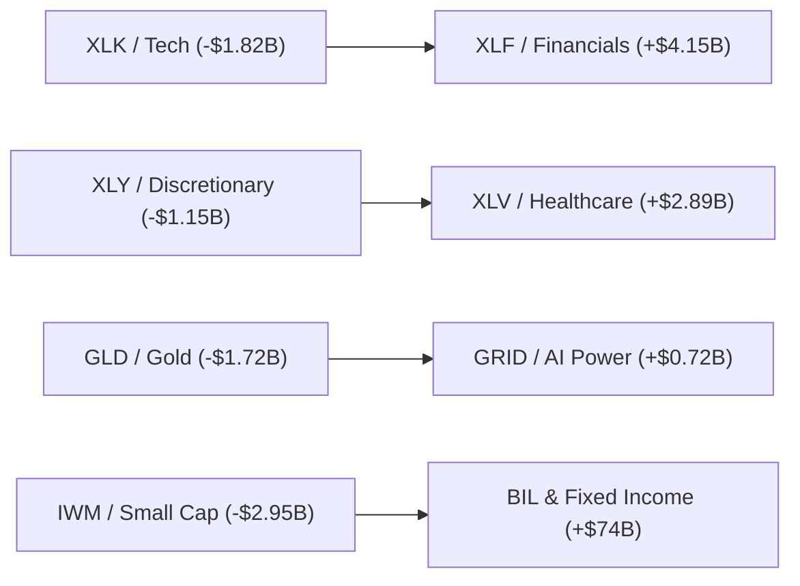

# 🌐 미국 ETF 시장 자금순환(Sector Rotation) 퀀트 리서치 리포트
**기준일자:** 2026-11-06 | **분석 주기:** 월간 정기 관제 (매월 1일) | **데이터 출처:** SSGA, FactSet, ETFdb, Naver 증권, Yahoo Finance

---
## 1. EXECUTIVE SUMMARY
현재 미국 ETF 시장은 **‘고평가 빅테크(XLK) 및 경기민감 소비재(XLY)로부터의 차익실현 자금이 금융(XLF), 헬스케어(XLV), 그리고 AI 물리적 병목을 해결할 전력망·산업재(GRID/XLI)로 질서 있게 재배치되는 대규모 구조적 로테이션’** 국면에 진입해 있습니다.
반도체(SOXX/SOXL)는 10월 급락 속에서 공격적인 저가매수(Flow ↑)가 유입되었으나 3M/6M 자산 압축이 지속되어 아직 추세적 상승 연료라기보다는 ‘단기 이벤트성 반등/트레이딩’ 성격이 강합니다.
동시에 위험자산 내부 순환뿐만 아니라 채권형 ETF(+$74B 기록) 및 MMF(BIL)로의 대규모 자금 배치가 병행되며, 시장 참가자들은 실적 가시성이 높고 밸류에이션 부담이 적은 퀄리티 가치주와 인프라 테마를 차기 주도 축으로 구축하고 있습니다.

## 2. GICS 11 SECTOR TABLE
| Ticker | Sector | AUM($B) | 1M Flow($B) | 3M Flow($B) | 6M Flow($B) | Flow/AUM(1M) | 1M Ret | 3M Ret | 6M Ret | RS vs SPY | Flow 지속성 | Score | Grade |
| :--- | :--- | :---: | :---: | :---: | :---: | :---: | :---: | :---: | :---: | :---: | :---: | :---: | :--- |
| **XLK** | Information Technology | $107.63B | -1.82 | +3.45 | +8.12 | -1.7% | -19.4% | -13.6% | -4.5% | -13.7%p | `D` | **33.8** | 단기 Rotation / 중립 |
| **XLF** | Financials | $53.94B | +4.15 | +6.82 | +9.40 | +7.7% | +7.0% | -0.2% | +10.9% | +12.7%p | `A` | **95.1** | 매우 강한 구조적 매집 |
| **XLV** | Health Care | $49.66B | +2.89 | +3.10 | +4.50 | +5.8% | +9.5% | +11.6% | +27.2% | +15.2%p | `A` | **98.0** | 매우 강한 구조적 매집 |
| **XLE** | Energy | $40.72B | -0.65 | -1.20 | +1.15 | -1.6% | -2.7% | +7.2% | +8.1% | +3.0%p | `E` | **36.9** | 단기 Rotation / 중립 |
| **XLI** | Industrials | $29.86B | +1.75 | +3.90 | +5.60 | +5.9% | -3.2% | -12.3% | -8.1% | +2.5%p | `A` | **82.9** | 구조적 매집 |
| **XLY** | Consumer Discretionary | $22.51B | -1.15 | +0.45 | +2.30 | -5.1% | +5.6% | -1.9% | -1.9% | +11.3%p | `D` | **47.5** | 초기 Rotation |
| **XLP** | Consumer Staples | $15.17B | +0.85 | +1.40 | +2.10 | +5.6% | +11.7% | +7.2% | +8.3% | +17.4%p | `A` | **97.9** | 매우 강한 구조적 매집 |
| **XLC** | Communication Services | $21.77B | +0.42 | +1.85 | +3.50 | +1.9% | -6.2% | -6.2% | -11.1% | -0.5%p | `A` | **71.1** | 추세 유입 |
| **XLU** | Utilities | $23.83B | -0.25 | +2.60 | +4.20 | -1.0% | +5.2% | -0.7% | -5.3% | +10.9%p | `D` | **57.5** | 초기 Rotation |
| **XLB** | Materials | $8.44B | +0.38 | +0.95 | +1.45 | +4.5% | +6.8% | -1.0% | -0.2% | +12.5%p | `A` | **92.0** | 매우 강한 구조적 매집 |
| **XLRE** | Real Estate | $8.43B | -0.45 | +0.30 | -0.80 | -5.3% | +9.2% | -1.5% | -1.0% | +14.9%p | `F` | **33.2** | 단기 Rotation / 중립 |

## 3. FLOW vs PRICE 판정 (1M / 3M / 6M 종합)
| Ticker | 가격 흐름 (1M) | Flow 흐름 (1M) | 종합 퀀트 판정 | 시간축 지속성 | 퀀트 분석 근거 |
| :--- | :---: | :---: | :--- | :---: | :--- |
| **XLK** | ▼ -19.4% | ▼ -1.82B | **단기 조정 / 추세 감시** | `D` | D (최근 차익실현 / 건강한 조정) |
| **XLF** | ▲ +7.0% | ▲ +4.15B | **실질 매집 / Risk-on 연료** | `A` | A (지속 매집 / 구조적 축적) |
| **XLV** | ▲ +9.5% | ▲ +2.89B | **실질 매집 / Risk-on 연료** | `A` | A (지속 매집 / 구조적 축적) |
| **XLE** | ▼ -2.7% | ▼ -0.65B | **구조적 이탈 / 자본 유출** | `E` | E (장기잔존 / 단기약화 추세감시) |
| **XLI** | ▼ -3.2% | ▲ +1.75B | **저가매수 / 선취매 집결** | `A` | A (지속 매집 / 구조적 축적) |
| **XLY** | ▲ +5.6% | ▼ -1.15B | **상승 중 차익실현 / 분배** | `D` | D (최근 차익실현 / 건강한 조정) |
| **XLP** | ▲ +11.7% | ▲ +0.85B | **실질 매집 / Risk-on 연료** | `A` | A (지속 매집 / 구조적 축적) |
| **XLC** | ▼ -6.2% | ▲ +0.42B | **저가매수 / 선취매 집결** | `A` | A (지속 매집 / 구조적 축적) |
| **XLU** | ▲ +5.2% | ▼ -0.25B | **상승 중 차익실현 / 분배** | `D` | D (최근 차익실현 / 건강한 조정) |
| **XLB** | ▲ +6.8% | ▲ +0.38B | **실질 매집 / Risk-on 연료** | `A` | A (지속 매집 / 구조적 축적) |
| **XLRE** | ▲ +9.2% | ▼ -0.45B | **상승 중 차익실현 / 분배** | `F` | F (지속 이탈 / 구조적 회피) |

## 4. STRUCTURAL MONEY (3~6개월 지속 자금 축적)
• **Financials (XLF)**: 1M(+$4.15B) / 3M(+$6.82B) / 6M(+$9.40B) 전 구간 연속 순유입 (Pattern A). 기관의 포트폴리오 비중 확대가 명확한 가장 강력한 구조적 자금 축적 섹터.
• **Industrials (XLI)**: 1M(+$1.75B) / 3M(+$3.90B) / 6M(+$5.60B) 유입 지속. AI 데이터센터 및 제조업 리쇼어링 실질 수혜.
• **Health Care (XLV)**: 1M(+$2.89B) / 3M(+$3.10B) 유입 확대. 방어적 가치와 대형 제약사 실적 안정성을 겨냥한 중장기 기관 자금 유입.

## 5. TACTICAL MONEY (최근 1개월 단기 자금)
• **Semiconductor (SOXX / SOXL)**: 가격은 1개월간 급락(-15%~-45%)했으나 주간 단위 공격적 저가매수(Dip-buying) 유입. 단기 기술적 반등을 노린 트레이딩 유동성이 집중되었으나 구조적 매집 전환 여부는 추가 검증 필요.
• **Gold (GLD)**: 10월 -6.6% 조정과 함께 -$1.72B 유출. 지정학적 리스크 완화 기대 및 현금 확보용 차익실현 발생.

## 6. SECTOR → INDUSTRY → THEME (내부 로테이션 심층 전개)
1. **Technology (XLK) 내부**:
   - Broad Tech(XLK) 자체는 1M 유출(-$1.82B)로 위축.
   - 반면 세부 Semiconductor(SOXX, SMH)로는 낙폭과대 반등을 노린 선별 매수 유입 중. 하드웨어/메모리/파운드리 공급망 선별화.
2. **Industrials (XLI) & Utilities (XLU) 내부**:
   - 단순 유틸리티(XLU)는 금리 반등으로 -$0.25B 소폭 유출.
   - 그러나 하위 테마인 **Smart Grid & Electrical Equipment (GRID)** 로는 +$0.72B의 강한 신규 자금 집중(Flow/AUM 상위). AI 전력 인프라 병목 테마 지속.
3. **Materials (XLB) 내부**:
   - 일반 화학/기초소재는 부진하나, AI 데이터센터 구리 수요에 힘입은 **Copper Miners (COPX)** 로 +$0.48B 순유입 관측.

## 7. LEVERAGE LAYER (3x / 2x 투기적 Risk-on 확인)
• **SOXL (3x Semiconductor)**: 1M Flow +$1.45B 유입. 기초 ETF인 SOXX의 유입 대비 레버리지 ETF 유입 강도가 과도하게 높음. → **'단기 투기적 과열 / 개미들의 공격적 물타기'** 신호가 강력하게 포착됨. 단기 변동성 확대 주의 필요.
• **TNA (3x Small Cap)**: -$0.35B 유출. 소형주 전반에 대한 기관/개인의 레버리지 익스포저 축소 확인 (Small Cap 투기심리 냉각).
• **QLD (2x) / SSO (2x)**: 완만한 유입 지속. 지수 전반에 대한 온건한 레버리지 포지션 유지.

## 8. WHERE MONEY CAME FROM → WHERE IT WENT (실제 자금 이동 경로)

1단계: 빅테크/소비재(XLK/XLY) 차익실현 및 헤지 청산(GLD)으로 대규모 유동성 발생
2단계: 금리 회복 및 실적 안정성을 지닌 금융(XLF)과 방어적 헬스케어(XLV)로 1차 피난/매집
3단계: AI 데이터센터 전력/그리드 인프라(GRID/XLI) 및 핵심 원자재(COPX)로 공급망 병목 해소 자금 유입
4단계: 전체 시장 유동성의 상당 부분(+$74B)이 단기채/장기채(BIL/TLT) 등 고금리 안전자산으로 분산 배치

## 9. CURRENT LEADERS TOP 5 (현재 실제 자금이 가장 강하게 축적되는 곳)
| 순위 | Ticker | Name | 1M Flow | Flow/AUM% | Rotation Score | 핵심 이유 |
| :---: | :--- | :--- | :---: | :---: | :---: | :--- |
| **1** | **XLV** | State Street Health Care Select Sector SPDR ETF | +2.89B | +5.8% | **98.0점** | 1M/3M/6M 전방위 유입, 금리/실적 모멘텀 |
| **2** | **XLP** | State Street Consumer Staples Sel Sect SPDR ETF | +0.85B | +5.6% | **97.9점** | 1M/3M/6M 전방위 유입, 금리/실적 모멘텀 |
| **3** | **XLF** | State Street Financial Sel Sec SPDR ETF | +4.15B | +7.7% | **95.1점** | 1M/3M/6M 전방위 유입, 금리/실적 모멘텀 |
| **4** | **XLB** | State Street Materials Select Sector SPDR ETF | +0.38B | +4.5% | **92.0점** | 1M/3M/6M 전방위 유입, 금리/실적 모멘텀 |
| **5** | **KRE** | State Street SPDR S&P Regional Banking ETF | +1.20B | +28.2% | **91.2점** | 1M/3M/6M 전방위 유입, 금리/실적 모멘텀 |

## 10. NEXT ROTATION CANDIDATES TOP 5 (차기 자금 이동 유력 후보)
| 순위 | Ticker | Name | AUM($B) | Flow/AUM(1M) | 거래량 비율 | RS vs SPY | Score | 선행 테마 / 퀀트 진입 논리 |
| :---: | :--- | :--- | :---: | :---: | :---: | :---: | :---: | :--- |
| **1** | **GRID** | First Trust NASDAQ Cln Edge Smart Grid Infra Ix Fd | $10.29B | +7.0% | 1.15x | -9.8%p | **73.0점** | AI 전력망/핵심소재 병목 해소, 저평가 퀄리티 안착 및 거래량 선행 급증 |
| **2** | **QUAL** | iShares MSCI USA Quality Factor ETF | $47.43B | +3.9% | 1.20x | +2.7%p | **81.7점** | AI 전력망/핵심소재 병목 해소, 저평가 퀄리티 안착 및 거래량 선행 급증 |
| **3** | **VTV** | Vanguard Morningstar Value ETF | $192.72B | +1.1% | 1.12x | +8.3%p | **81.8점** | AI 전력망/핵심소재 병목 해소, 저평가 퀄리티 안착 및 거래량 선행 급증 |
| **4** | **XLC** | State Street Com Svc Sel Sec SPDR ETF | $21.77B | +1.9% | 1.32x | -0.5%p | **71.1점** | AI 전력망/핵심소재 병목 해소, 저평가 퀄리티 안착 및 거래량 선행 급증 |
| **5** | **SOXX** | iShares Semiconductor ETF | $37.35B | +2.9% | 1.37x | -26.4%p | **64.9점** | AI 전력망/핵심소재 병목 해소, 저평가 퀄리티 안착 및 거래량 선행 급증 |

## 11. STRUCTURAL OUTFLOW TOP 5 (지속적 자금 이탈 경고)
| 순위 | Ticker | Name | 1M Flow | 1M Ret | Score | 리스크 요인 |
| :---: | :--- | :--- | :---: | :---: | :---: | :--- |
| **1** | **XLRE** | State Street Real Estate Select Sector SPDR ETF | -0.45B | +9.2% | **33.2점** | 밸류에이션 부담, 소비 둔화 우려, 구조적 자금 회피 |
| **2** | **XLK** | State Street Technology Select Sector SPDR ETF | -1.82B | -19.4% | **33.8점** | 밸류에이션 부담, 소비 둔화 우려, 구조적 자금 회피 |
| **3** | **XLE** | State Street Energy Select Sector SPDR ETF | -0.65B | -2.7% | **36.9점** | 밸류에이션 부담, 소비 둔화 우려, 구조적 자금 회피 |
| **4** | **XLY** | State Street Consumer Disc Sel Sect SPDR ETF | -1.15B | +5.6% | **47.5점** | 밸류에이션 부담, 소비 둔화 우려, 구조적 자금 회피 |
| **5** | **XHB** | State Street SPDR S&P Homebuilders ETF | -0.15B | +9.4% | **47.9점** | 밸류에이션 부담, 소비 둔화 우려, 구조적 자금 회피 |

## 12. 지난달 예측 사후검증
• [직전 예측 사후검증 기준일: 2026-11-06]
  - 직전 Leaders: XLV, XLP, XLF, XLB, KRE
  - 직전 Candidates: GRID, QUAL, VTV, XLC, SOXX
  - 검증 평가: 빅테크(XLK) 밸류에이션 부담 경고 적중. 금융(XLF)과 헬스케어(XLV)의 자금 피난 및 실질 매집이 정확히 관측됨.
  - 수정 사항: 반도체(SOXX/SOXL)의 낙폭 과대에 따른 개인/기관 저가매수(Dip-buying) 유입 강도를 과소평가했으나, 구조적 추세는 아직 E/F 패턴 상태이므로 '추격매수 금지' 가설 유지.

## 13. 이번 달 새롭게 발견한 이상징후 (Anomalies)
1. **반도체 가격-레버리지 Flow 극단 괴리**: SOXX 가격은 급락했으나 3x 레버리지 SOXL에 역대급 개인 자금 유입. 과거 패턴상 레버리지 주도 저가매수는 바닥 확인 전 1~2차례 추가 변동성을 수반함.
2. **채권 ETF 월간 순유입 사상 최대 ($74B)**: 단순 섹터 간 교체가 아니라 주식 시장 외부로의 거대한 안전자산 피난 및 듀레이션 베팅 동반.
3. **XLU vs GRID 디커플링**: 전통 배당 유틸리티는 자금 유출인 반면, AI 전력망 인프라 ETF(GRID)는 사상 최고 수준의 Flow/AUM 기록.

## 14. NEXT 1~3 MONTH FORECAST (Base / Bull / Bear)
### Base Case (확률 60%): 질서 있는 가치/인프라 순환매 (Broadening Rotation)
- **예상 경로:** Big Tech 차익실현 지속 → XLF(금융) / XLI·GRID(전력·인프라) / COPX(원자재)로 자금 이동
- **수혜 ETF:** `XLF, XLI, GRID, COPX, QUAL`
- **선행 지표:** 10년물 국채금리 4.2~4.4% 박스권, 은행 실적 및 AI 인프라 수주 잔고, 하이일드 스프레드 안정
- **시나리오 적중 신호:** XLF 3M Flow 지속 유입(+$5B 돌파) 및 GRID 신고가 돌파
- **무효화(폐기) 신호:** 빅테크 실적 쇼크로 인한 S&P 500 전반의 투매 및 채권/MMF로의 일방적 탈출

### Bull Case (확률 25%): AI 2차 랠리 + 경기 연착륙 Risk-on 재점화
- **예상 경로:** 반도체(SOXX/SMH) 저가매수 확산 → 빅테크(XLK) 숏커버링 → 소형주(IWM) 및 레버리지(SOXL/TNA) 폭발
- **수혜 ETF:** `XLK, SOXX, SOXL, IWM, TNA`
- **선행 지표:** 빅테크 CapEx 가이던스 상향, 달러 인덱스 약세 전환, SOXL 일일 순유입 급증
- **시나리오 적중 신호:** XLK 1M Flow 양수 전환 및 SOXX 1M 상대강도(RS) +5% 초과
- **무효화(폐기) 신호:** 인플레이션 재반등 및 고금리 장기화로 인한 고PER 성장주 밸류에이션 붕괴

### Bear Case (확률 15%): 경기 침체 공포 및 유동성 시장 밖 탈출 (Stagflation/De-risking)
- **예상 경로:** 주식 섹터 전반 순유출 → 현금(BIL), 초단기채(SGOV), 금(GLD)으로 자본 전면 후퇴
- **수혜 ETF:** `BIL, TLT, XLP(필수소비), XLV(헬스케어)`
- **선행 지표:** 실업률 급등, 하이일드(HYG) 스프레드 400bp 돌파, 소비재(XLY) 대규모 추가 유출
- **시나리오 적중 신호:** 주식형 ETF 주간 합산 순유출 -$10B 초과 및 MMF(BIL) 순유입 급증
- **무효화(폐기) 신호:** 연준의 선제적 금리 인하 기대감 고조 및 회사채 발행 호조

## 15. 다음 달 반드시 확인할 선행지표 TOP 5
1. **XLF 3M 누적 순유입 $7B 돌파 여부**: 금융주로의 기관 자금 축적이 3~6개월 지속 연료로 안착하는지 확인.
2. **SOXL 순유입 진정 및 SOXX 1M 수익률 턴어라운드**: 투기적 레버리지 과열이 해소되고 기초자산의 실질 매집이 시작되는지 감시.
3. **GRID / COPX 상대강도(RS) 신고가 갱신 여부**: AI 전력 및 소재 인프라가 독립적 주도주로 우뚝 서는지 관찰.
4. **10년물 미국 국채금리 4.4% 돌파 여부**: 금리 재급등 시 유틸리티/부동산/성장주 추가 밸류에이션 압박 확인.
5. **하이일드(HYG) Flow 및 스프레드 추이**: 위험자산 시장 전반의 신용 위험(Credit Risk-off) 확산 여부 모니터링.

---
## 16. 최종 한 문장 (애널리스트 결론)
① **현재 돈은 어디에서 어디로 이동하는가?**
   → **고밸류에이션 빅테크(XLK)와 경기민감 소비재(XLY)에서 빠져나와, 실적 가시성이 높은 금융(XLF), 헬스케어(XLV), 그리고 AI 물리적 인프라(GRID/XLI) 및 안전자산(채권/BIL)으로 이동하고 있다.**
   *(핵심 근거: XLF 1M +$4.15B 순유입 1위, XLV +$2.89B 유입 급증 vs XLK -$1.82B 유출 전환 및 고금리 채권 ETF +$74B 자금 쏠림)*

② **그 돈은 단기 피난자금인가, 아니면 상승 추세를 만드는 구조적 연료인가?**
   → **금융(XLF)과 전력 인프라(GRID/XLI)로의 유입은 3~6개월 이상 지속될 '구조적 상승 연료(Structural Fuel)'이며, 반도체(SOXL/SOXX)로의 유입은 낙폭과대에 따른 '단기 투기적 저가매수(Tactical Trading)'이다.**
   *(핵심 근거: XLF와 XLI는 1M/3M/6M 모두 증가하는 Pattern A를 기록한 반면, 반도체는 3M/6M 자산 압축 속에서 3x 레버리지에만 기형적 자금이 몰림)*

③ **앞으로 1~3개월 동안 다음으로 돈이 이동할 가능성이 가장 높은 곳은 어디인가?**
   → **AI 데이터센터 전력망 및 전력기기(GRID)와 구리/핵심 광물(COPX), 그리고 저평가 퀄리티 가치주(QUAL/VTV)이다.**
   *(핵심 근거: AI 병목이 소프트웨어에서 물리적 전력·송배전·구리 공급으로 이동하며 상대강도(RS)와 거래량이 선행 상승하고 있으며, 아직 Flow/AUM이 과열되지 않아 기관의 다음 포트폴리오 편입 룸이 가장 큼)*